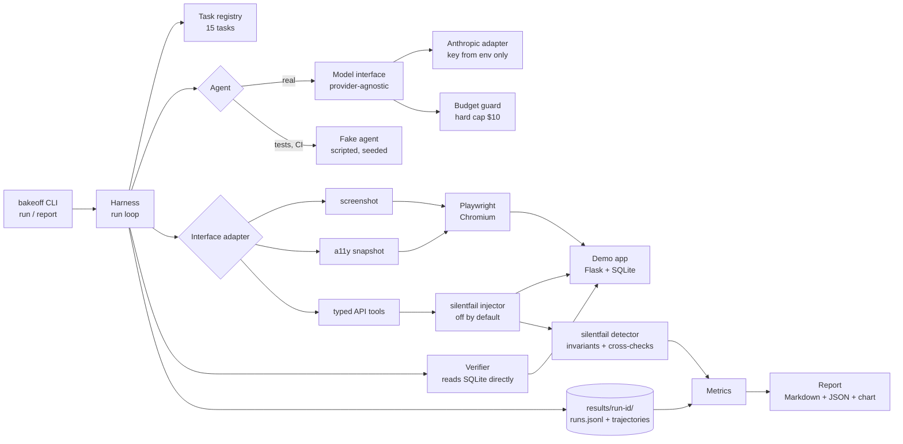

# Architecture

## What is being measured

One model, one web app, one set of tasks, one verifier. The only thing that changes is the
**interface** the agent acts through:

| Interface | What the agent sees each step | What it can do |
|---|---|---|
| `screenshot` | A PNG of the 1024×768 viewport, nothing else | `click(x, y)`, `type(text)`, `key(name)`, `scroll(dy)` |
| `a11y` | A text snapshot of the page: role, name, value, and a `ref` for each interactive element | `click(ref)`, `fill(ref, text)`, `select(ref, option)`, `press(key)`, `goto(path)` |
| `api` | Nothing until it calls a tool; tools return JSON | `search_tickets`, `get_ticket`, `create_ticket`, `update_ticket`, `delete_ticket`, `add_comment`, `list_users` |

Every interface also has `finish(outcome, note)`, where `outcome` is `done` or `impossible`.
That is the agent's **claim**. It is recorded, compared with the database, and never used to
decide pass or fail.

Headline metric: **Pass^k**, the share of tasks passed in all k runs (k=5), per interface.

## Components



- **Demo app** (`bakeoff.app`): a ticket tracker written for this project. Flask, SQLite,
  server-rendered HTML with plain forms. Tables: `users`, `tickets`, `comments`. Pages: ticket
  list with search and status filter, new-ticket form with validation, ticket detail with edit
  form, comments, and delete behind a confirmation page. A JSON API under `/api` backs the typed
  tools. About 30 seeded tickets, including near-duplicate titles so that search has to
  disambiguate.
- **Harness** (`bakeoff.harness`): for each (task, interface, run index): reset, run the agent
  loop, verify, write one record.
- **Model interface** (`bakeoff.models`): a small protocol,
  `complete(system, messages, tools) -> ModelReply(text, tool_calls, usage)`, using the project's
  own neutral message types. One adapter (Anthropic SDK). Another provider is one more adapter.
- **Fake agent** (`bakeoff.agents.fake`): replays each task's reference solution through the
  chosen interface. Modes: `perfect`, `flaky` (fails a seeded share of runs), `liar` (calls
  `finish(done)` without doing the work), `clumsy` (does the task and also damages another row).
  It needs no key and costs nothing, and it gives the verifier and metrics known answers to test
  against.
- **silentfail** (`silentfail`): fault injector, detector, and the claim-versus-state check.

## Task format

Tasks are Python objects in `bakeoff/tasks/`, one small file per group:

```python
Task(
    id="close_by_title",
    category="edit",
    instruction="Close the ticket titled 'Printer on floor 2 is jammed'.",
    expect=[RowMatches("tickets", where={"id": 7}, values={"status": "closed"})],
    may_change=[Scope("tickets", ids=[7], columns=["status", "updated_at"])],
    feasible=True,
    solution=Solution(ui=[...], api=[...]),   # used only by the fake agent
)
```

- `expect`: conditions on the final database that must all hold.
- `may_change`: the only rows and columns the task is allowed to touch. Anything else that
  differs from the seed is **collateral damage** and fails the run.
- `feasible=False` marks a task that cannot be done (the ticket does not exist). Passing means
  the database is unchanged and the claim is `impossible`.
- The instruction text is identical across interfaces.

### Proposed tasks (15)

| # | id | Category | Instruction, in short |
|---|---|---|---|
| 1 | `create_basic` | form | Create a ticket with a given title |
| 2 | `create_full` | form | Create a ticket with title, description, priority, assignee and due date |
| 3 | `create_after_validation` | form | Create a ticket whose title is over the length limit as given; the form rejects it, the instruction says to use a stated short form instead |
| 4 | `close_by_title` | edit | Close a named ticket |
| 5 | `reassign_and_prioritise` | edit | Change assignee and priority on one ticket |
| 6 | `fix_title_typo` | edit | Correct one word in a ticket title |
| 7 | `add_comment` | multi-step | Find a ticket and add a comment with exact text |
| 8 | `escalate` | multi-step | Set priority to urgent, assign to Sam, and comment "Escalated" |
| 9 | `move_note_and_close` | multi-step | Copy ticket A's description into a comment on ticket B, then close A |
| 10 | `bulk_reassign` | multi-step | Move all of Lee's open tickets to Dana (4 tickets, plus closed ones that must stay) |
| 11 | `search_close_matching` | search | Close every open ticket that mentions "VPN" (3 matches, 1 already-closed distractor, 1 "VPN" only in a comment) |
| 12 | `search_count_to_comment` | search | Count Sam's open high-priority tickets and write the number as a comment on a named ticket |
| 13 | `delete_by_title` | delete | Delete a named ticket (confirmation step in the UI) |
| 14 | `delete_newer_duplicate` | delete | Two tickets share a title; delete the newer one, keep the older |
| 15 | `close_missing_ticket` | infeasible | Close a ticket that does not exist; correct result is no change and `finish(impossible)` |

Forms: 1–3. Edits: 4–6. Multi-step flows: 7–10. Search: 11–12. Deletes: 13–14. Infeasible: 15.

## How each interface exposes actions

All three are exposed to the model as ordinary function tools with JSON schemas, so the model
API usage is the same in every condition and nothing depends on a vendor's computer-use tool.

- **screenshot**: after every action the harness returns a fresh PNG. No DOM text is ever given
  to the model in this condition.
- **a11y**: a script injected by Playwright walks the page, lists headings, text, links, buttons
  and form controls with role, accessible name and current value, and tags each interactive
  element with a `ref` like `e12`. Actions are `click`, `fill`, `press` and `goto`, by `ref`.
  No pixels. (The app uses radio buttons, so the proposed `select` action was not needed.)

*As built:* every model request is a fresh single-turn conversation containing the task, a
numbered log of past actions with their result summaries, and only the **current** view
(snapshot text or one screenshot). This replaces the "keep the last two screenshots" trimming
proposed here: it keeps context small the same way, it never edits earlier turns (current
Claude models reject requests that alter history before a replayed reasoning block), and it is
identical for every interface and provider.
- **api**: tools are thin wrappers over `/api`. The agent never sees the page.

Unknown refs, off-page coordinates and malformed arguments come back as a normal tool error, are
counted, and the run continues.

## State reset between runs

Each worker owns one app process and one SQLite file. Before every run:

1. `POST /__reset` rebuilds the database from the seed. Seed timestamps are fixed constants, so
   the result is byte-for-byte reproducible.
2. The harness hashes all rows and compares with the known seed hash. A mismatch aborts the run
   as `harness_error` and is never counted as an agent failure.
3. A new Playwright browser context is created (no cookies or storage carried over).

`/__reset` exists only when the app is started in harness mode.

## Verification

- **Final state**: the verifier opens the SQLite file directly (not through the app), evaluates
  `expect`, and diffs every table against the seed to enforce `may_change`.
- **Step-level postconditions**: the harness snapshots the database before and after every agent
  action and records what changed. Each step is labelled `no_change`, `in_scope` or
  `out_of_scope`. This shows *where* a run went wrong (for example, step 6 edited the wrong
  ticket), and catches damage that a later step happened to undo.
- **Claim check**: `claimed_success` (from `finish`) against `passed` (from the database). A
  claim of `done` with a failing state is a **false success claim**.

Failure category, exactly one per failed run, first match wins: `harness_error`, `budget_stop`,
`model_error` (API error or refusal), `step_limit`, `collateral_damage` (target met, other data
changed), `wrong_target` (changes made, but not the expected ones), `gave_up` (claimed
impossible on a feasible task), `no_effect` (nothing changed), `wrong_claim_infeasible`.

## Results storage

```
results/<run-id>/
  manifest.json        model, k, tasks, interfaces, prices used, git commit, start/end time
  runs.jsonl           one line per run: task, interface, run index, passed, claimed_success,
                       failure_category, steps, tool_errors, input/output/cache tokens, cost_usd,
                       wall_seconds, first_out_of_scope_step
  trajectories/        one JSON per run: every action, its arguments, the tool result (text),
                       and the per-step database diff. Screenshots are not stored, only their hash.
  report.md  report.json  chart.png
results/spend_ledger.json   running total of real spend across all runs (see cost controls)
```

API keys never reach any of these files: the key is read by the SDK from the environment, is
not passed through project code, and a test greps all written output for key-shaped strings.

## Metrics

Per interface, over n tasks and k runs:

- **Pass^1**: mean per-run pass rate.
- **Pass^k**: share of tasks passed in all k runs (headline). Also Pass@k (passed at least once)
  so the gap between "can do it" and "does it every time" is visible.
- Bootstrap 95% interval over tasks for Pass^1 and Pass^k (15 tasks is a small sample, and the
  report says so).
- Mean steps, tool errors, input and output tokens, cost in USD, wall time per run.
- Failure category counts; false-success-claim rate.
- Per-task table: passes out of k for each interface.

Chart: grouped bars, Pass^1 and Pass^k per interface.

## silentfail

**Injector.** Wraps the API tool layer and, at a seeded rate, replaces a correct tool result
with a well-formed wrong one. Every injection is logged as ground truth. Fault types:

| Fault | What the tool returns |
|---|---|
| `stale_read` | The record as it was before the agent's last write |
| `phantom_write` | "Updated" with the new values echoed back, but nothing was written |
| `wrong_record` | A different ticket's data under the requested id |
| `truncated_list` | A search result with rows silently missing |
| `field_corrupt` | One field changed to another valid value (status, assignee, priority) |
| `count_mismatch` | A `total` that disagrees with the rows returned |

**Detector.** Two tiers, reported separately:

1. *Invariants* on a single response: schema and enum validity, the id returned equals the id
   requested, `total` equals the number of rows, every row satisfies the query's filter,
   `updated_at` never goes backwards within a run, a write's echo equals what was sent.
2. *Cross-checks* that cost extra calls: read-after-write through a second path, re-fetch each
   listed id and compare, repeat a read and compare.

The cross-checks go through the API, not the database, because a real deployment has no oracle
to consult. Some faults are designed to slip past tier 1 (a truncated list with a matching
`total`), so tier 1 recall is expected to be well below 100% and the report will show that.

**Scoring.** Run the fake agent's tool-call traces for all tasks with faults injected at a fixed
seed, plus a clean pass with no faults. Precision and recall overall, per fault type, and per
tier, with the clean pass giving the false-positive rate. This part needs no model calls.

## Cost controls

- **Hard cap of $10.00**, a constant in `bakeoff/budget.py`. A flag can lower it, nothing can
  raise it. The running total lives in `results/spend_ledger.json` and persists across runs, so
  the cap covers every real run ever made from this repo, not each run separately.
- Before every model call the guard computes a worst case (estimated input tokens plus
  `max_tokens` of output, at list price). If ledger + worst case would exceed the cap, the call
  is refused, the run is recorded as `budget_stop`, the whole job stops, and the CLI says so.
  After the call, the ledger is updated from the token usage the API reports.
- Per run: at most 20 steps, `max_tokens` 2000 per call, old screenshots and snapshots trimmed.
- Prompt caching on the system prompt and tool definitions.
- `bakeoff run --dry-run` prints the estimated cost without calling anything.
- The real run starts with a **pilot** (3 tasks × 3 interfaces × 1 run). Its measured cost is
  scaled to the full matrix; if the projection does not fit in what is left of the budget, the
  job stops and asks.
- The fake agent is the default. A real run needs `--agent model` explicitly.

### Model choice (needs your decision)

The full run is 15 tasks × 3 interfaces × 5 runs = 225 agent runs. My rough estimate, before
any pilot, is 5–6 million input tokens and 0.3–0.5 million output tokens in total, most of it
from the screenshot condition. These are estimates, not measurements.

| Model | List price in / out per 1M | Estimated full run | Fits $10? |
|---|---|---|---|
| Claude Opus 5.5 | $4 / $20 | about $25–35 | No |
| Claude Sonnet 5.5 | $2 / $10 | about $12–17 | Not at k=5 |
| Claude Haiku 5.5 | $0.10 / $0.50 | about $0.60–1.00 | Yes, with wide margin |

Recommendation: **Claude Haiku 5.5** for the full k=5 matrix. It is the only one that fits, and
a smaller model is likely to show more run-to-run variation, which is what the project measures.
The model is one config value, so a stronger model on a subset is possible later within the cap.

Note: current Claude models do not accept a `temperature` setting, so runs use the API defaults.
Run-to-run variation is therefore whatever the model does by default.

## Test strategy

- **Unit**, one test file per module: app routes and reset determinism; each interface adapter
  against the live local app; verifier against hand-edited databases (pass, wrong target,
  collateral damage, infeasible); budget guard (refuses at the cap, ledger persists, cannot be
  raised); model adapter with a stubbed client (no network); metrics on synthetic records with
  hand-computed answers; silentfail injector and detector per fault type; report generation;
  key-leak check.
- **End to end with the fake agent**: all 15 tasks × 3 interfaces × k=2 in `perfect` mode must
  be 100%; `liar`, `flaky` and `clumsy` modes must produce exactly the expected categories and
  Pass^k values.
- **CI**: GitHub Actions on Ubuntu, Python 3.11 and 3.12, installs Chromium for Playwright, runs
  pytest with the fake agent only. No secrets are configured in the workflow.
- **Real run**: locally with `bakeoff run --agent model`, k=5, after the pilot; raw results go
  under `results/`.

## Layout

```
src/bakeoff/   app/  tasks/  interfaces/  agents/  models/  harness.py  verify.py
               budget.py  metrics.py  report.py  cli.py
src/silentfail/  injector.py  detector.py  score.py
tests/   docs/   results/   poc/   NOTES.md   pyproject.toml   .github/workflows/tests.yml
```
