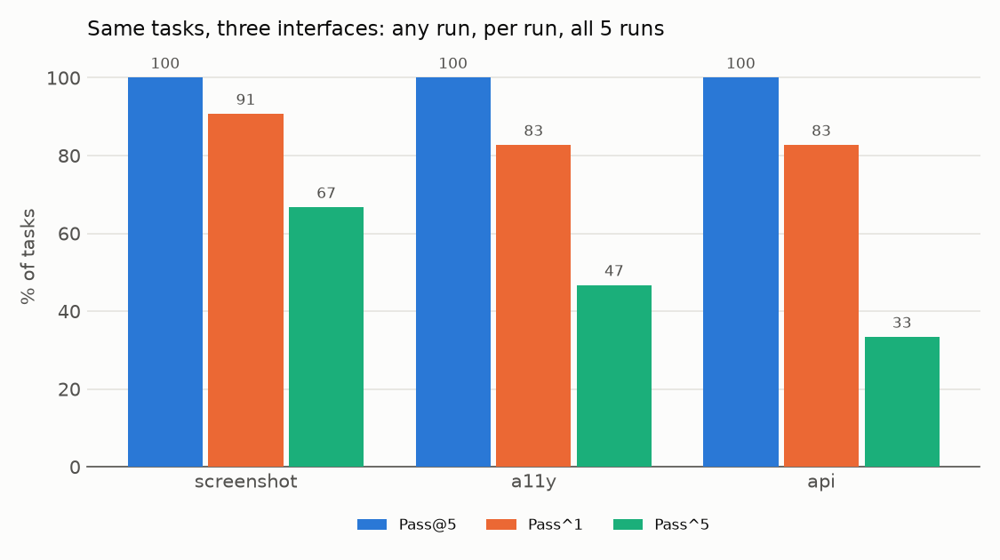

# Results: fake-flaky-k5

- Agent: **fake agent (flaky)**
- Tasks: 15; interfaces: screenshot, a11y, api; k = 5
- Runs recorded: 225 of 225 planned
- Started 2026-11-14T07:07:34+00:00, ended 2026-11-14T07:08:45+00:00; git commit None
- Total model cost of this run: **$0.0000**

## Reliability

Pass^5 is the share of tasks passed in **all** 5 runs. Pass^1 is the per-run pass rate. Pass@5 is the share passed at least once. Brackets: 95% bootstrap interval over tasks.

| Interface | Pass^5 | Pass^1 | Pass@5 | Tasks with all 5 runs | False success claims |
|---|---|---|---|---|---|
| screenshot | **67%** (40-87) | 91% (83-97) | 100% | 15 of 15 | 7 of 75 runs |
| a11y | **47%** (20-73) | 83% (73-92) | 100% | 15 of 15 | 13 of 75 runs |
| api | **33%** (13-60) | 83% (73-91) | 100% | 15 of 15 | 13 of 75 runs |

## Effort and cost per run (means)

| Interface | Actions | Model turns | Tool errors | Input tokens | Output tokens | Cost | Seconds | Total cost |
|---|---|---|---|---|---|---|---|---|
| screenshot | 8.2 | 5.9 | 0.0 | 0 | 0 | $0.0000 | 1.4 | $0.0000 |
| a11y | 4.6 | 5.6 | 0.0 | 0 | 0 | $0.0000 | 0.9 | $0.0000 |
| api | 1.8 | 2.8 | 0.1 | 0 | 0 | $0.0000 | 0.0 | $0.0000 |

## Failed runs by category

| Category | screenshot | a11y | api |
|---|---|---|---|
| no_effect | 7 | 12 | 13 |
| wrong_claim_infeasible | 0 | 1 | 0 |

## Per task: runs passed out of 5

| Task | Category | screenshot | a11y | api |
|---|---|---|---|---|
| `create_basic` | form | 3/5 | 5/5 | 3/5 |
| `create_full` | form | 4/5 | 5/5 | 5/5 |
| `create_after_validation` | form | 5/5 | 3/5 | 4/5 |
| `close_by_title` | edit | 3/5 | 3/5 | 5/5 |
| `reassign_and_prioritise` | edit | 5/5 | 5/5 | 5/5 |
| `fix_title_typo` | edit | 5/5 | 4/5 | 4/5 |
| `add_comment` | multi_step | 5/5 | 5/5 | 4/5 |
| `escalate` | multi_step | 4/5 | 5/5 | 4/5 |
| `move_note_and_close` | multi_step | 5/5 | 2/5 | 4/5 |
| `bulk_reassign` | multi_step | 5/5 | 4/5 | 2/5 |
| `search_close_matching` | search | 4/5 | 5/5 | 4/5 |
| `search_count_to_comment` | search | 5/5 | 4/5 | 4/5 |
| `delete_by_title` | delete | 5/5 | 5/5 | 5/5 |
| `delete_newer_duplicate` | delete | 5/5 | 3/5 | 4/5 |
| `close_missing_ticket` | infeasible | 5/5 | 4/5 | 5/5 |
